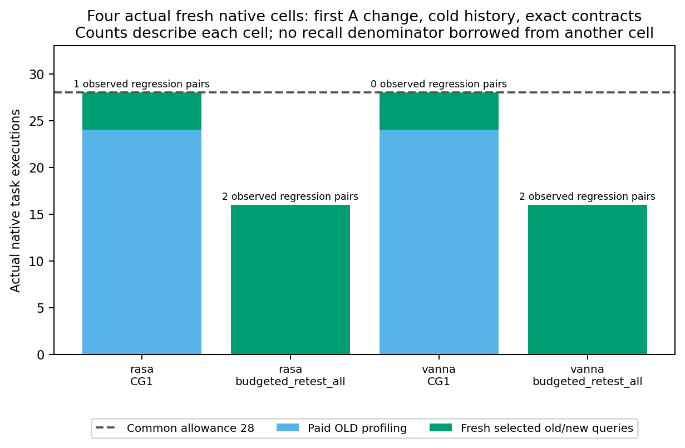
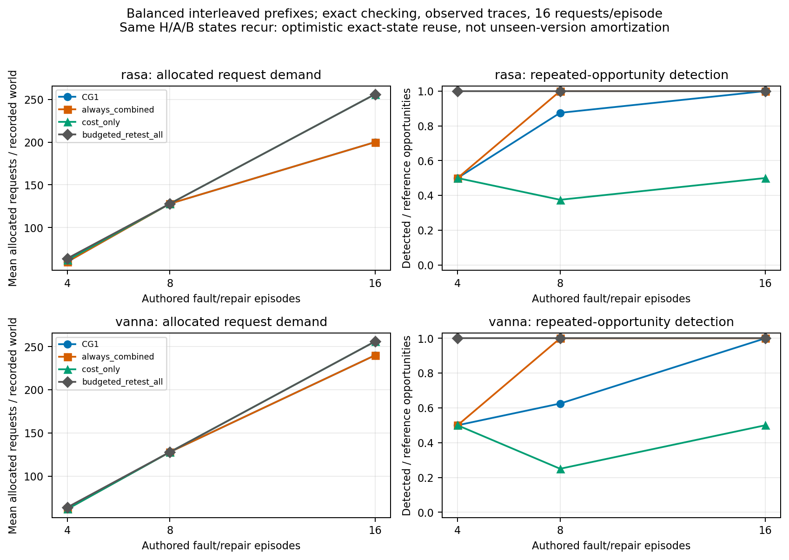
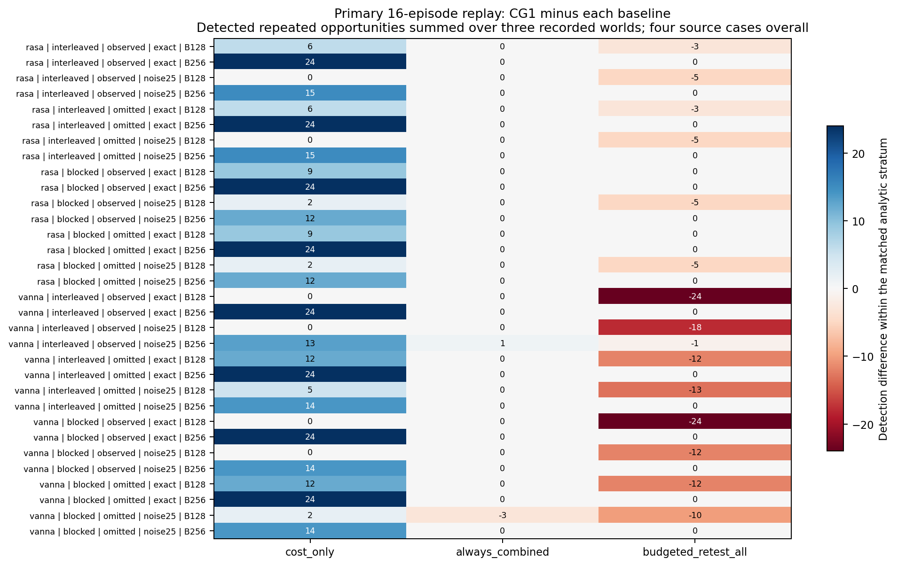

# Budgeted AI Regression Testing: Case Studies, Code and Results

This repository accompanies a bounded empirical study of **how impact evidence,
operational failure judgments and acquired test history interact when evidence
acquisition and test execution share a limited budget**. It contains the study
code, case definitions, completed reports, result tables and graphs, and entry
points to the complete, hash-verified evidence archives.

The experiments are complete. The main conclusion is conditional: buying
evidence can consume the budget needed to reveal regressions; reuse can recover
that overhead when identical states recur; and historical feedback can help or
harm later selection. **The study does not establish a universally superior
selector or externally validated selection guidance for complete unseen
applications.**

## Start here

| Goal | Entry point |
|---|---|
| Understand every main finding and its limits | [Results explained](docs/RESULTS.md) |
| Inspect the four historical source changes | [Case studies](docs/CASE_STUDIES.md) |
| Understand the recorded execution environments | [Environments](docs/ENVIRONMENTS.md) |
| Verify and reconstruct the saved results offline | [Reproducibility instructions](docs/REPRODUCIBILITY.md) |
| Read the complete main study report | [Vanna/Rasa report](experiment/RESULTS_TRANSFER_V9.md) |
| Read the separate supporting study report | [OpenWebUI/Dify report](experiment/RESULTS_DEVELOPMENT_V8.md) |
| Browse the primary machine-readable tables and graphs | [Main-study results](results/v9/) |
| Inspect the native LaTeX/TikZ chart sources | [TikZ figures](results/tikz/) |
| Inspect the original native TikZ figure sources | [TikZ sources and usage notes](results/tikz/) |
| Obtain all manifest-bound raw observations and frozen source bytes | [Release assets](https://github.com/narimanmani/budgeted-ai-regression-testing/releases/tag/v1.0.0) |

## Research questions

1. How do paid evidence acquisition and exact-state reuse change detection and
   request demand relative to simple retesting in cold and recurring workloads?
2. How do selective or incomplete impact evidence and acquired history interact,
   and how do controlled operational judgment errors change those interactions?
3. When does the unchanged CG1 history gate help or harm detection relative to
   fixed combinations and inexpensive controls?

The contribution is an empirical characterization of these mechanisms and their
operating limits. A characteristic-to-technique map, a new semantic oracle and a
new state-of-the-art selection algorithm are not claimed.

## Two complementary studies

The version labels `v8` and `v9` identify separate completed studies. Their
observations, budgets and evidence archives remain separate.

| Study | Executed setting | Completed evidence | What it establishes |
|---|---|---|---|
| Supporting native ordering study (`v8`) | OpenWebUI 0.12.5 and Dify 1.18.0; factual document-label workloads | 80 primary native trajectories; separate configuration development, reference acquisition, full-suite diagnostic and post hoc sensitivity | Small history-gating gains, coarse-impact limits and reference/index-instance transfer problems |
| Main interaction study (`v9`) | Vanna SQL/visualization and Rasa form/ranking paths | Four independently sourced historical source faults; 376 completed native observations; one retained failed initialization; 672 primary and 1,344 secondary recorded-outcome trajectories; four fresh policy cells | Paid acquisition, exact-state reuse and controlled impact-history-judgment interactions within a fixed frame |

Vanna executes actual local Qwen generation, SQLite queries and generated Plotly
code. Rasa executes native dialogue actions and trained CountVectors/logistic
ranking; **Rasa is not a generative LLM subject**. The earlier OpenWebUI/Dify
study executes native ingestion, indexing, retrieval and generation.

### What is a native observation, a replay trajectory and a detection?

- A **native observation** executes a task on its recorded application path.
- A **replay trajectory** allocates previously recorded native outcomes while
  changing admission, ordering, feedback and budget conditions. It creates no
  new application or model response.
- A reference-revealing pair passes the executable contract in the old state
  and fails it in the new state. In the main study, a counted detection also
  requires the strategy's operational judgment to recognize that transition.
- A failure in both states is an existing failure, rather than a new regression.
  Multiple tasks or repetitions revealing one fault do not create new bugs.

The main study has **four independent historical fault mechanisms**. Its 2,016
replay trajectories and 18,816 decisions are not independent defect samples.

## Methods and budget accounting

The fixed mechanism arms are profiled latency ordering (`C`/`cost_only`), impact
plus latency (`I`/`impact_only`), history plus latency (`H`/`history_only`) and
always-combined (`IH`/`always_combined`). The main study also includes seeded
random ordering and budgeted catalog-order retesting. CG1 selects among the
fixed combinations using paid predecision evidence and its own earlier
operational observations.

CG1 enables impact only for a checked proper subset of the catalog. It enables
history only when earlier positive paired events have known change tokens that
overlap the current change. One incompatible positive event can disable history
globally, including useful local feedback. CG1 was frozen before the new case
search and was not changed after the results were observed.

The main comparison constrains **native-request counts**, not elapsed time.
Each selected old/new pair costs two units. Profile-consuming methods buy three
old executions for each of eight tasks in each distinct old state: 24 requests
per state, at most 72 across recurring H/A/B states. Random and catalog retesting
buy no profiles. Disabling a mechanism does not refund profiles already bought.

Histories contain only a strategy's own earlier selected operational pairs.
Reference outcomes and another strategy's history are not free decision inputs.
Measured native wall intervals, controller CPU and the explicitly named hybrid
wall-plus-CPU proxy remain separate quantities.

## Main results

### 1. Full retesting wins the fresh small cold-start comparisons

Each cell has the same 28-request allowance, empty initial history and exact
operational contracts. Counts are revealing pairs from that method's own fresh
executions; they are not recall denominators borrowed from the other arm.

| Setting | Method | Profile requests | Selected endpoints | Total requests | Observed revealing pairs |
|---|---|---:|---:|---:|---:|
| Vanna | CG1 | 24 | 4 | 28 | 0 |
| Vanna | Full paired retesting | 0 | 16 | 16 | 2 |
| Rasa | CG1 | 24 | 4 | 28 | 1 |
| Rasa | Full paired retesting | 0 | 16 | 16 | 2 |



For an eight-task suite, three old profiles per task already cost 24 requests,
whereas all old/new pairs cost 16. This disadvantage follows from the specified
acquisition protocol; the live executions show the resulting observed
detections. The four cells cover a first A change only.

### 2. Identical-state reuse creates a conditional crossover

Under observed edges, exact judgments and balanced interleaved order, CG1 matches
all repeated detections at 16 changes using fewer requests than full retesting.
Detection counts below aggregate three recorded passes; request demand is per
trajectory, including acquisition.

| Setting | Changes | CG1 detections | Full detections | CG1 requests | Full requests |
|---|---:|---:|---:|---:|---:|
| Rasa | 4 | 6/12 | 12/12 | 60 | 64 |
| Rasa | 8 | 21/24 | 24/24 | 128 | 128 |
| Rasa | 16 | 48/48 | 48/48 | 200 | 256 |
| Vanna | 4 | 6/12 | 12/12 | 62 | 64 |
| Vanna | 8 | 15/24 | 24/24 | 128 | 128 |
| Vanna | 16 | 48/48 | 48/48 | 240 | 256 |



The 16-change savings are 56 requests in Rasa (21.9%) and 16 in Vanna (6.25%).
The sequences revisit the **same H/A/B states** with exact-state caching;
this is not measured amortization over continuously unseen versions. Impact-only
and always-combined also attain complete detection in those favorable cells.

### 3. Complementarity is limited and changes with operational errors

Across the 32 primary additive detection contrasts,
`Delta_IH = D(IH) - D(I) - D(H) + D(C)`:

| Sign of contrast | Primary conditions |
|---|---:|
| Positive | 3 |
| Zero | 21 |
| Negative | 8 |

All positives occur in Vanna at the smaller request ceiling. Perturbing
operational verdicts reduces the contrast in 10 of the 16 matched conditions
and leaves 6 unchanged. The perturbation probability is 0.25; it is an authored
stress treatment, not an estimate of natural checker error.

A negative contrast need not mean the combined arm is worse than either
standalone arm. For example, C=10, H=16 and I=IH=22 give a contrast of -6 even
though combined still detects more than C or H. [Detailed interpretation and
examples](docs/RESULTS.md#impact-history-interaction-and-judgment-errors).

### 4. CG1 is not consistently preferable to simpler controls

Each comparison covers 32 analytic condition strata, aggregating three recorded
passes. A detection tie does not imply equal alarms, demand or execution time.

| Comparator | CG1 gains | Ties | CG1 losses |
|---|---:|---:|---:|
| Budgeted catalog retesting | 0 | 17 | 15 |
| Seeded random | 2 | 15 | 15 |
| Profiled latency C | 26 | 6 | 0 |
| Impact plus latency I | 8 | 23 | 1 |
| History plus latency H | 20 | 10 | 2 |
| Always-combined IH | 1 | 30 | 1 |



Against always-combined, CG1 gains one repeated detection in one stratum and
loses three in another: two fewer overall, with equal allocated request demand.
The preserved unfavorable comparisons are part of the result.

### 5. The supporting native study finds a small, localized gain

| Method | Detected / 64 repeated opportunities | Discordant alarms | Allocated queries across 16 trajectories |
|---|---:|---:|---:|
| Profiled latency C | 16/64 | 0 | 1,184 |
| Impact plus latency I | 16/64 | 0 | 1,184 |
| History plus latency H | 25/64 | 2 | 1,184 |
| Always-combined IH | 25/64 | 2 | 1,184 |
| CG1 | 27/64 | 2 | 1,184 |

The two extra detections occur in Dify warm history and do not recur in both
execution repetitions at either budget. CG1 still misses 37/64 opportunities.
Every impact block admits all eight tasks, so this study does not identify a
selective-impact benefit. A separate full-suite diagnostic detects 16/16
opportunities using 48 queries per three-change sequence; it exceeds the
primary online pair ceilings and is not a sixth matched primary arm.

OpenWebUI also exposes reference-instance instability: a task that passes in the
reference index returns a bracketed label in a later native index, violating
the same bare-label contract. The original results and a separately labeled
post hoc sensitivity are both retained. [Supporting results explained](docs/RESULTS.md#supporting-native-ordering-study-v8).

## Inspect or reconstruct the results

No model, container, paid API or GPU is needed for the supported **saved-data
reanalysis**. Use Python 3.12 (verified with 3.12.14), download a complete release
archive, verify its hash and extract it into its own empty directory. Then run
the included verification and reconstruction tools. The two studies must be
extracted separately because each archive has its own manifest.

See [the exact commands and expected outputs](docs/REPRODUCIBILITY.md). Native
reexecution is a different task: it requires separately acquired pinned model,
binary, container and application assets and adaptation of recorded host paths.
This repository does not promise a portable one-command native relaunch.

The release helpers provide a checked entry point from the cloned repository:

```text
python scripts/download_evidence.py --study all
python -I -B scripts/reproduce.py --study v9 --output reproduced/v9
python -I -B scripts/reproduce.py --study v8 --output reproduced/v8
```

Use Python 3.12 for `reproduce.py`. The downloader checks complete ZIP hashes,
and the reproduction wrapper verifies extracted tree bytes before importing
frozen analysis code. The reproduction commands use new output directories.

## Repository and archive organization

```text
README.md                         Overview, key numerical results and navigation
docs/                             Case studies, full result interpretation and reproduction
experiment/RESULTS_TRANSFER_V9.md  Sealed main-study report
experiment/RESULTS_DEVELOPMENT_V8.md
experiment/transfer_v9/            Main design, cohorts, case bindings, runners and auditors
experiment/development_v8/         Supporting design, evaluator and archive tooling
results/v9/                       CSV tables, PNG/SVG figures and presentation receipts
results/v8/                       Compact supporting-study summaries
results/tikz/                     Five original native TikZ figure sources and usage notes
evidence/                         Original archive manifests, guides and ZIP checksums
scripts/                          Release download and saved-data reproduction helpers
```

Complete immutable raw evidence, full frozen dependencies and native receipts
are distributed in the [release archives](https://github.com/narimanmani/budgeted-ai-regression-testing/releases/tag/v1.0.0).
Treat each archive's manifest and `ARTIFACT_README.md` as the authoritative map
for reproducing that sealed study. Browsable repository files provide navigation
and explanation; they do not replace the manifest-bound evidence tree.

The original November 1 reports and archive guides retain historical statements
about then-unpublished artifacts and author-release TODOs. Their bytes are
preserved for provenance. This GitHub release is a later distribution wrapper;
it does not rewrite the completed scientific record, issue a DOI or confer an
artifact-evaluation badge.

## Citation, rights and research assistance

Use [CITATION.cff](CITATION.cff) to cite this versioned research artifact.
No journal acceptance, DOI or reproducibility badge is implied. The exact
upstream terms are retained in [THIRD_PARTY_NOTICES.md](THIRD_PARTY_NOTICES.md);
[LICENSE.md](LICENSE.md) explains that there is no blanket relicensing of this
mixed collection.

Codex assisted with protocol drafting, software implementation and debugging,
execution orchestration, saved-data checking, data presentation and writing.
Qwen2.5-7B supplied the evaluated application generations; the reference judgments
came from executable contracts. The retained source, native outputs, freezes and
audit receipts are the evidence for the reported results. Such software checks
do not substitute for author review of the research requirements and conclusions.

## Limits to carry forward

- Four historical source mechanisms, small authored catalogs and repeated
  fault/repair sequences are not a random sample of natural maintenance changes.
- The main longitudinal comparisons are recorded-outcome replay; fresh live
  policy execution covers only cold first changes with exact judgments.
- One generative weight snapshot was used. Model replacement, model-weight
  regression and human semantic-answer quality were not evaluated.
- Rasa forms begin with parsed entity events, and its ranking path uses a
  non-generative trained classifier. Neither study validates an entire unseen
  deployed application.
- Edge omissions and judgment flips are synthetic, precommitted stresses;
  they do not measure natural prevalence or separate immediate recognition
  errors from all subsequent feedback effects.
- Native-request quotas, measured wall intervals, controller CPU and the hybrid
  proxy are different units. No production wall-budget optimum or energy saving
  is established.
- Separate checking implementations and guarded reconstruction establish
  consistency of the preserved evidence, not external industrial replication
  or independent human validation of the reference requirements.

The next research direction is deciding whether evidence should be purchased at
all and validating any revised guidance prospectively on new changes and
complete workflows. The present cases would then be development evidence for
that revised rule, rather than its untouched validation set.
